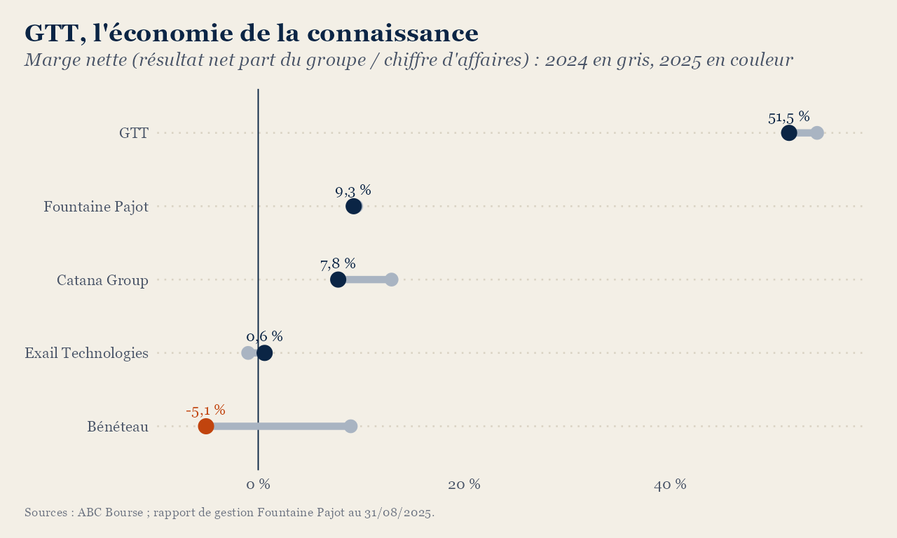
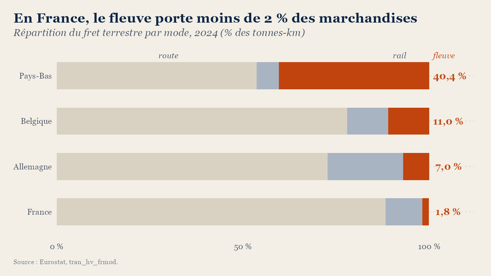
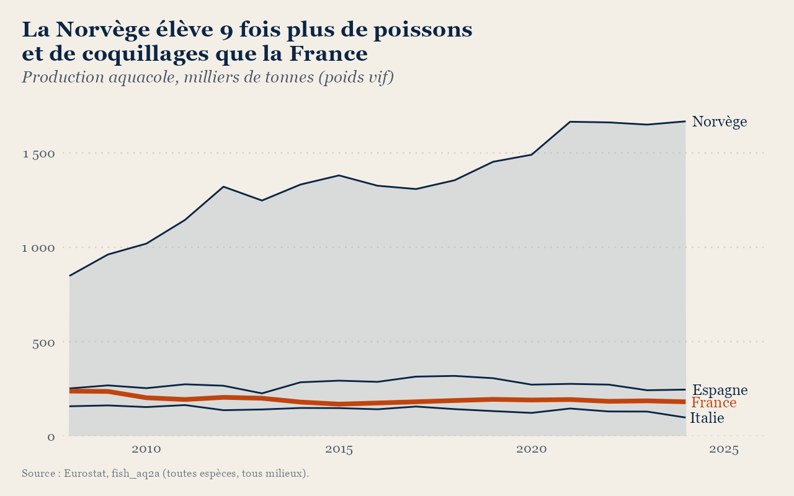
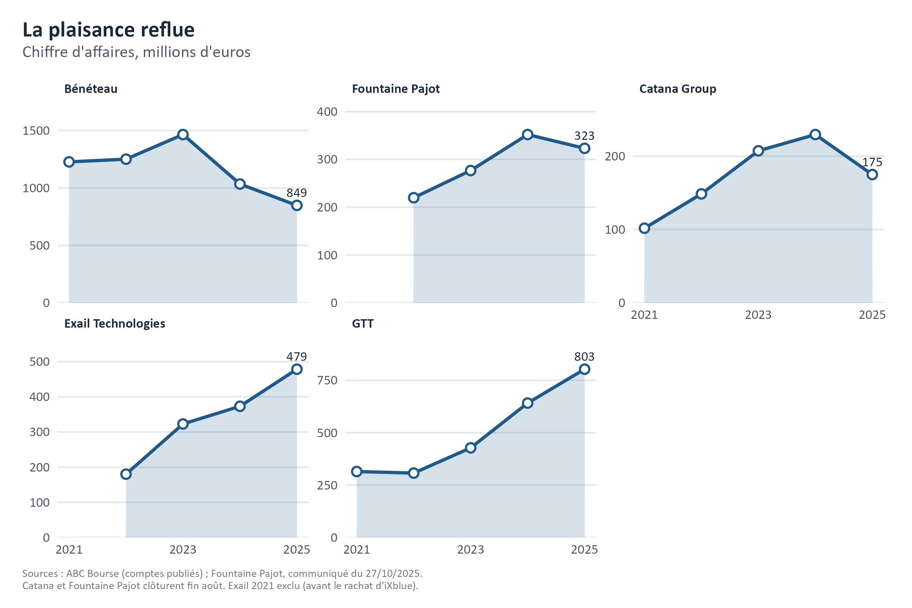
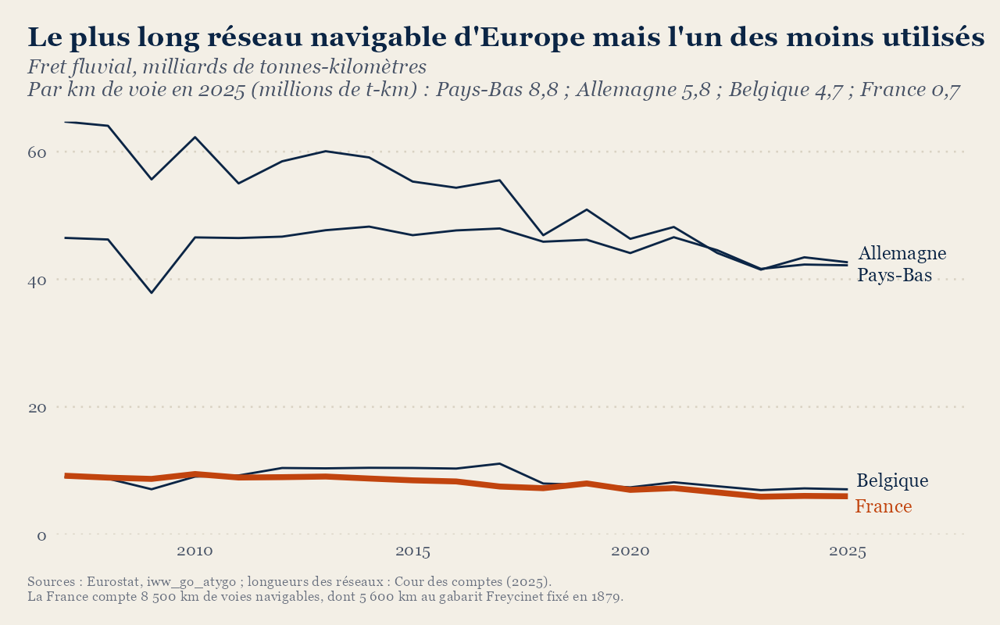

# La France et la mer : un savoir-faire réel, un espace délaissé

« La mer n'a pas été constitutive de la Nation française », écrit l'Académie de marine ; la France possède pourtant le
deuxième plus vaste espace maritime du monde, et son littoral borde tous les océans sauf l'Arctique. Ce projet mesure ce qu'elle en fait aujourd'hui, à partir de
données publiques et des comptes de cinq industriels français de la mer.



## Résultats

**La mer est peu cultivée.** En 2024, la Norvège produit 1,67 million de tonnes de poissons et de coquillages d'élevage ;
la France, 181 000 tonnes, soit neuf fois moins. Sa production a d'ailleurs reculé d'un quart depuis 2008, alors que celle
de la Norvège doublait.

**Le savoir-faire existe ; il sert surtout le loisir.** Bénéteau, Fountaine Pajot et Catana comptent parmi les premiers
constructeurs mondiaux de voiliers et de catamarans ; Fountaine Pajot, par exemple, réalise 87 % de ses ventes à l'export.
Le marché de la plaisance est toutefois très sensible à la conjoncture : après le pic de 2023, le chiffre d'affaires de
Bénéteau a chuté de 42 % et sa marge nette est passée de +12,6 % à −5,1 %. Fountaine Pajot résiste mieux, avec une marge
proche de 9 % ; Catana reste rentable, mais recule.

**La valeur se trouve dans la connaissance.** GTT ne construit aucun navire ; elle conçoit les cuves des méthaniers et
perçoit des redevances auprès des chantiers, surtout coréens et chinois. Son chiffre d'affaires a atteint 803 M€ en 2025,
avec une marge nette de 51,5 %. Le contraste avec Bénéteau résume le paradoxe français : la France vend le savoir, tandis
que la construction, elle, s'est déplacée en Asie.

**La technologie de souveraineté reste à rentabiliser.** Exail (drones maritimes, navigation, lutte contre les mines) a
multiplié son chiffre d'affaires par 2,7 depuis 2022 ; sa rentabilité nette demeure cependant proche de zéro. C'est la seule
des cinq entreprises dont l'activité sert directement la surveillance et la connaissance de l'espace maritime français.

## Ouverture : le fleuve, ou le déclin technique

La mer ne s'arrête pas au littoral ; elle se prolonge par les fleuves. Or la France possède le plus long réseau navigable
d'Europe, 8 500 km, et s'en sert de moins en moins. Le fret fluvial est passé de 12,7 milliards de tonnes-kilomètres en 1970
à 5,6 milliards en 2023, son plus bas historique (Cour des comptes) ; le fleuve ne porte plus que 1,8 % des marchandises,
contre 40 % aux Pays-Bas (Eurostat). Rapporté à la longueur du réseau, l'écart se creuse encore : en 2025, chaque kilomètre
de voie navigable française a porté 0,7 million de tonnes-kilomètres, contre 4,7 en Belgique, 5,8 en Allemagne et 8,8 aux
Pays-Bas. Le Rhin, qui apporte à ces deux derniers un important trafic de transit, explique une partie de la différence ;
la Belgique, qui n'en bénéficie pas, fait pourtant près de sept fois mieux.

La raison tient moins à la nature du transport fluvial qu'à l'état du réseau. Sur ces 8 500 km, 5 600 relèvent encore du
gabarit fixé par la loi Freycinet de 1879, conçu pour des péniches de moins de 400 tonnes ; aux Pays-Bas et en Allemagne,
les grands axes accueillent des bateaux de plusieurs milliers de tonnes. Le grand gabarit ne représente que 24 % du réseau
français, contre 70 % en Allemagne. Faute d'entretien, la dette accumulée atteignait 1,1 milliard d'euros en 2023 ; en juin
2024, 643 écluses et 110 barrages étaient en état fortement dégradé.

Le camion domine donc parce qu'il est rapide, souple et fiable, mais aussi parce que les autres modes n'ont pas été
modernisés. La Cour des comptes le reconnaît : l'infrastructure est une condition « nécessaire, mais non suffisante »,
puisque les grands axes déjà rénovés pourraient absorber trois à quatre fois plus de trafic. Le problème est donc double ;
il faut à la fois renouveler le réseau et réorganiser la filière. Le fleuve, enfin, mène à la terre, qui fera l'objet du
projet suivant.



## Limites

- **Cinq années de comptes seulement** (2021-2025). Elles couvrent le boom d'après-Covid puis le retournement, mais pas un
  cycle complet ; Fountaine Pajot n'a que deux années de résultat net dans les données retenues.
- **Exercices décalés.** Catana et Fountaine Pajot clôturent fin août ; leur « 2025 » va de septembre 2024 à août 2025.
- **Périmètres changeants.** Exail est issu du rachat d'iXblue par Groupe Gorgé en 2022 ; l'année 2021 est donc exclue.
  Le périmètre de Fountaine Pajot a lui aussi bougé en 2024-2025 (−10,3 % de ventes à périmètre constant, contre −8,2 %
  publié).
- **Deux sources pour le fluvial.** Eurostat et le ministère (repris par la Cour des comptes) ne mesurent pas exactement le
  même trafic ; les ordres de grandeur concordent, pas les décimales.
- **L'aquaculture agrège tout** : saumon norvégien, huîtres et moules françaises n'ont ni la même valeur ni le même modèle.
  La comparaison porte sur les volumes, pas sur la valeur ajoutée.

## Reproduire

```
cd donnees && python extraire_abcbourse.py && cd ..
Rscript analyse.R
```
Le premier script extrait les comptes des pages ABC Bourse enregistrées dans `donnees/brut/` ; le second écrit les
graphiques et `resultats.txt` dans `sorties/`. Packages R : dplyr, tidyr, ggplot2, scales. Le détail des sources figure
dans `donnees/SOURCES.md`.

## Sources

- Eurostat : aquaculture [fish_aq2a](https://ec.europa.eu/eurostat/databrowser/view/fish_aq2a/default/table),
  fret fluvial [iww_go_atygo](https://ec.europa.eu/eurostat/databrowser/view/iww_go_atygo/default/table),
  part modale [tran_hv_frmod](https://ec.europa.eu/eurostat/databrowser/view/tran_hv_frmod/default/table).
- Comptes des entreprises : [ABC Bourse](https://www.abcbourse.com) (Bénéteau, Catana Group, Exail Technologies, GTT) ;
  Fountaine Pajot, [rapport de gestion au 31/08/2025](https://www.fountaine-pajot.com/wp-content/uploads/2025/12/FP-RapportGestion-31-08-2025.pdf)
  et communiqué du 27/10/2025.
- Cour des comptes, [*L'entretien des voies navigables : l'exemple de VNF*](https://www.ccomptes.fr/fr/publications/lentretien-des-voies-navigables-lexemple-de-vnf), février 2025.
- Assemblée nationale, [questionnaire budgétaire adressé à VNF](https://www.assemblee-nationale.fr/dyn/contenu/visualisation/884308/file/2025-01-17%20Questionnaire%20compl%C3%A9t%C3%A9%20VNF%20Laurent%20H%C3%A9nart.pdf), janvier 2025.
- Académie de marine, [*France, ambition maritime*](https://www.academiedemarine.fr/wp-content/uploads/2025/10/France-ambition-maritime-2025-1.pdf), 2025.

## Graphiques

| | |
|---|---|
|  |  |
|  |  |
